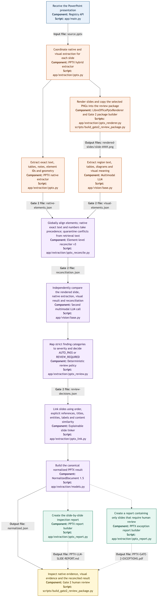

# PPTX ingestion and Gate 2 review pipeline

The diagram deliberately shows only the PPTX flow. It separates the two
extraction paths and identifies which stages produce files that can be inspected
in the timestamped Gate 2 run.

- The native path extracts exact PowerPoint text, tables, notes, element IDs and
  geometry.
- The visual path renders selected slide images under
  `rendered-slides/slide-####.png` and sends them to the multimodal model.
- The deterministic reconciler aligns the native and visual evidence. Native
  extraction remains authoritative for exact text, numbers, and labels;
  conflicting visual text is quarantined from retrieval content.
- A second multimodal call independently judges the rendered image, native
  evidence, first visual result, and reconciliation. Code maps its strict
  categories to severity and decides whether human review is required.
- `normalized.json` is the canonical reconciled result.
- `native-elements.json`, `visual-elements.json`, `reconciliation.json`, and
  `review-decisions.json` are Gate 2 snapshots shown beside their stages.
- `PPTX-LLM-SLIDE-REPORT.md` is the human-readable slide report.
- `PPTX-GATE-2-EXCEPTIONS.pdf` contains only slides requiring human review.

Connector labels show the files available for Gate 2 inspection.

The editable Mermaid source is
[`ingestion-pipeline.mmd`](ingestion-pipeline.mmd).
