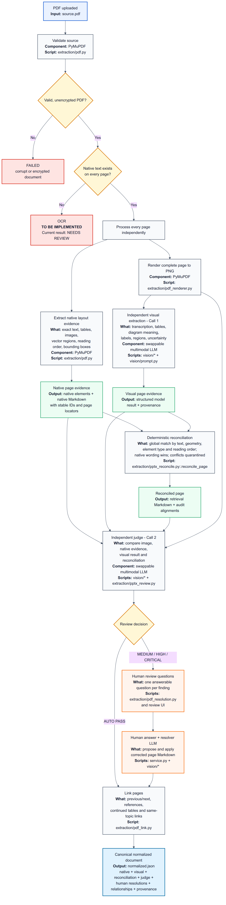

# PDF ingestion pipeline

This diagram describes the implemented production-quality PDF route through
canonical normalization. It does not include chunking, embedding, or retrieval.

Every non-transcript PDF page follows two independent evidence paths:

1. PyMuPDF extracts positioned native elements: exact text, tables, embedded
   images, vector regions, reading order, and normalized bounding boxes.
2. PyMuPDF renders the complete page and the configured multimodal provider
   performs an independent visual extraction without receiving native text.

Python reconciles those evidence streams deterministically. Native extraction
has precedence for exact wording, numbers, dates, names, and labels. Visual
evidence contributes supported chart, diagram, and layout meaning. Conflicts are
retained for audit but quarantined from the derived normalized Markdown.

A second multimodal call independently judges the rendered page, both raw
evidence streams, and the reconciliation. Medium, high, or critical findings
become page-specific questions in the existing human review UI. Applied human
resolutions are stored with model and prompt provenance before the final
`normalized.json` is accepted.

OCR is deliberately not implemented in this phase. A page without native text
is preserved as partial evidence and routed to `NEEDS_REVIEW` with
`OCR_REQUIRED`; the diagram shows the future OCR component as a separate red
rectangle.

PyMuPDF runs locally and requires no API key. Its AGPL/commercial licensing must
be reviewed before closed-source production distribution.
