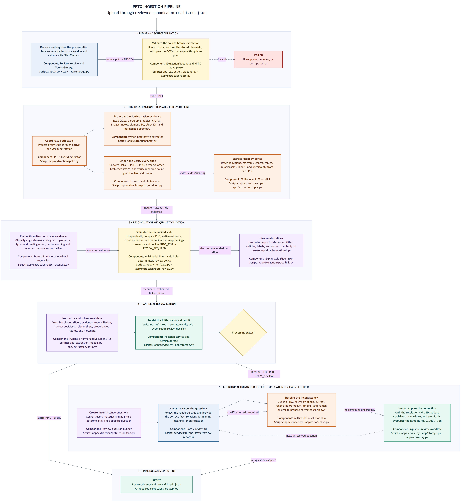

# PPTX ingestion pipeline

This diagram covers only the implemented PPTX ingestion path, beginning with
upload and ending with the reviewed canonical `normalized.json`. It includes
the conditional human-correction loop because a `NEEDS_REVIEW` presentation is
not ready for downstream use. Chunking, embedding, Qdrant publication, and
document approval remain outside this diagram.

Two different validation responsibilities are shown:

1. **Source validation** routes `.pptx`, confirms the stored source exists,
   computes its content hash, and verifies that `python-pptx` can open the OOXML
   package. Unsupported, missing, or corrupt inputs fail before hybrid
   extraction.
2. **Reconciliation-quality validation** uses a second multimodal call to judge
   the rendered slide, native evidence, first visual result, and deterministic
   reconciliation. The deterministic policy maps findings to severity and
   decides `AUTO_PASS` or `REVIEW_REQUIRED`.

The first multimodal call extracts visual meaning; it does not override exact
native wording or numbers. The deterministic reconciler retains complementary
visual meaning and quarantines conflicting visual text from retrieval content.

The runtime does not persist `native-elements.json`, `visual-elements.json`,
`reconciliation.json`, or `review-decisions.json` as independent pipeline
outputs. Those are inspection views created by the separate Gate 2 package
builder. In the runtime pipeline, the same evidence is embedded in each slide
inside `normalized.json`.

When all slides pass, the extraction status becomes `READY`. If material
discrepancies require human review, the partial but canonical `normalized.json`
is still written and the status becomes `NEEDS_REVIEW`.

For `NEEDS_REVIEW`, deterministic questions are created from the material
findings. A person answers each question, a resolution multimodal model proposes
corrected Markdown from the slide evidence and human answer, and the person
explicitly applies the correction. Applying a resolution updates
`human_resolutions` and the slide's `combined_markdown`, then atomically
overwrites the same `normalized.json`; it does not create a second normalized
file. When all questions are applied, processing becomes `READY`.

Document approval remains a separate lifecycle action after normalization. A
`READY` normalized document can therefore still belong to a `DRAFT` document
version until a person explicitly approves it.

The editable Mermaid source is
[`pptx-ingestion-pipeline.mmd`](pptx-ingestion-pipeline.mmd).
