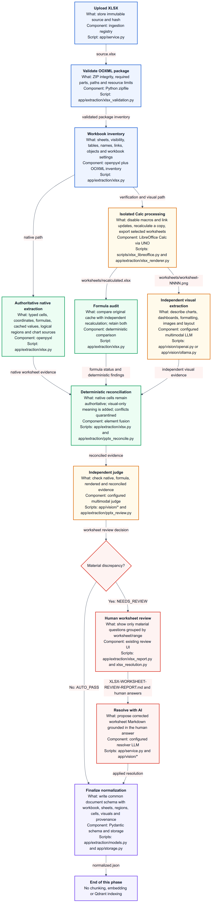

# XLSX ingestion pipeline

This process covers XLSX ingestion through `normalized.json`. It deliberately
stops before chunking, embedding, Qdrant indexing, and retrieval.

## Authority rule

Native workbook evidence has precedence for exact cell text, numbers, dates,
coordinates, formulas, table ranges, and named ranges. LibreOffice recalculation
and multimodal descriptions are independent supporting evidence. They cannot
silently replace native values.

## Processing

1. `xlsx_validation.py` validates the OOXML ZIP structure and rejects unsafe or
   oversized packages before openpyxl or LibreOffice opens them.
2. `xlsx.py` inventories all worksheets, including hidden sheets, tables, named
   ranges, formulas, merged cells, charts, images, pivots, validation rules,
   conditional formatting, external links, and embedded objects.
3. Logical worksheet units are declared Excel tables first, named ranges second,
   and deterministic occupied-cell regions last. The first non-empty worksheet
   row is no longer assumed to describe the entire sheet.
4. LibreOffice Calc opens an isolated copy with macros and external-link updates
   disabled, recalculates formulas, saves `worksheets/recalculated.xlsx`, and
   exports selected worksheets to `worksheets/worksheet-NNNN.png`.
5. Formula expressions, original cached values, and independently recalculated
   values are all retained in `normalized.json`. A changed, missing, erroneous,
   or external result becomes an auditable finding.
6. Selective visual extraction runs only for worksheets containing formulas,
   charts, images, merged cells, conditional formatting, pivots, hidden content,
   external dependencies, embedded objects, or ambiguous table headers. Set
   `INGESTION_XLSX_VISUAL_MODE=all` to render every non-empty worksheet.
7. Deterministic reconciliation suppresses duplicate visual text, adds genuine
   visual-only meaning, and quarantines conflicts. The independent judge then
   assigns the same `AUTO_PASS` or `REVIEW_REQUIRED` status used by PPTX and PDF.
8. Material findings appear in `XLSX-WORKSHEET-REVIEW-REPORT.md` and the existing
   UI review workflow. Applied human answers update the reconciled worksheet
   output before `normalized.json` becomes ready for acceptance.

## Main normalized XLSX records

- `workbook_metadata`: package audit, date system, calculation mode, names,
  external links, and embedded objects.
- `worksheets`: state, used range, tables, regions, cells, formulas, charts,
  visual evidence, reconciliation, review, and human resolutions.
- `blocks`: common cross-format retrieval text with worksheet and exact cell-range
  source locators.
- `quality`: warnings, counts, and extraction status.
